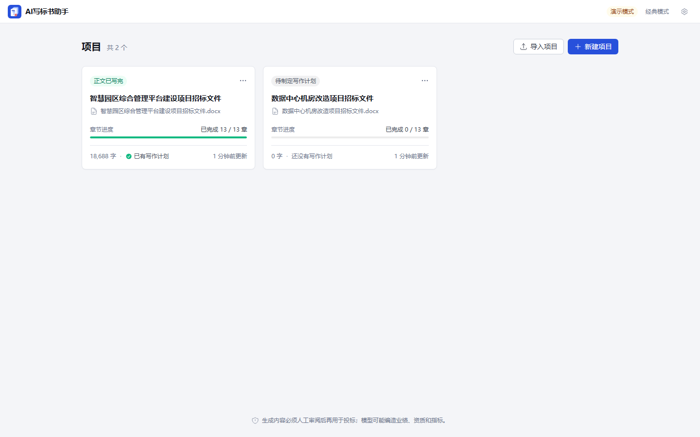
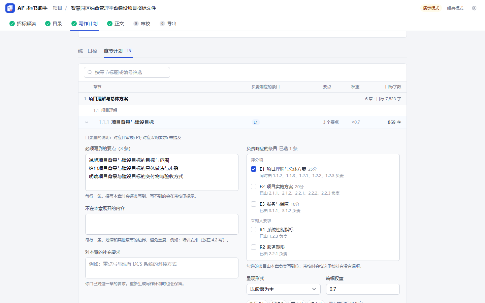
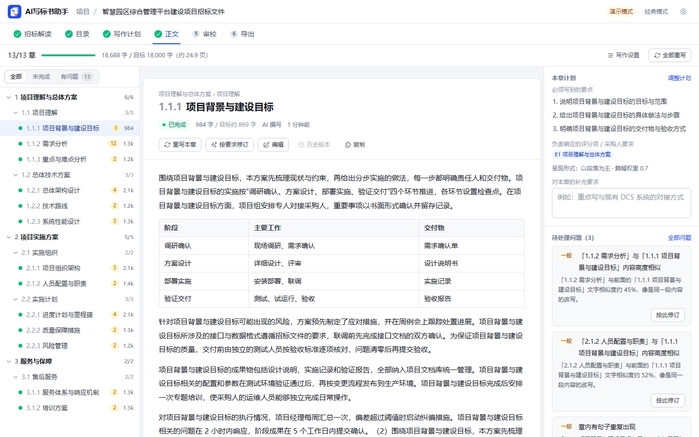
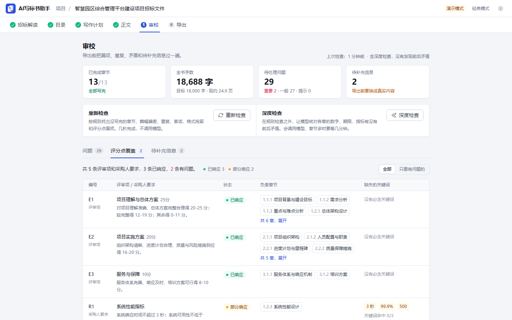
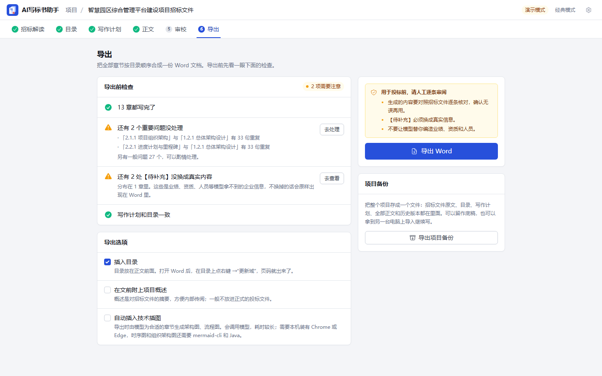

<p align="center">
  <picture>
    <source media="(max-width: 600px) and (prefers-color-scheme: dark)" srcset="docs/brand/hero-compact-dark.svg">
    <source media="(max-width: 600px)" srcset="docs/brand/hero-compact-light.svg">
    <source media="(prefers-color-scheme: dark)" srcset="docs/brand/hero-dark.svg">
    
  </picture>
</p>

<h1 align="center">AI写标书助手</h1>

<p align="center">
  
  
  
  
</p>

本地运行的 AI 标书写作助手：上传招标文件，解析项目概述与评分要求，生成三级目录，先定全书的统一口径和各章写作计划，再分章撰写、审校，最后导出 Word。

任意 OpenAI 兼容接口均可使用，推荐 DeepSeek。API Key、项目数据和全部稿件都保存在本机；解析和撰写时，招标文件的内容会发给你配置的模型服务（见「说明」）。

## 功能

- **项目工作台**：每个投标项目一个工作区，数据落在本机磁盘；关掉浏览器、重启服务都不丢，可以导出备份、换一台电脑导入
- **招标解读**：上传 Word / PDF，流式提取项目概述和技术评分要求，结果可手改；超长招标文件自动分段提取再合并；扫描件会明确提醒
- **目录生成**：自由组织，或与评分项一一对应；可以参考旧方案的目录；树形编辑，改目录不丢已写的正文
- **写作计划**：动笔前先归纳全书的「统一口径」（招标给定的约束、方案的总体设定、统一术语），再给每章定要点、负责响应的评分项、篇幅权重
- **正文撰写**：后台任务逐章撰写，实时显示；可以随时停止、继续、重试失败的章节；单章可重写、按要求修订、手动编辑，保留历史版本
- **审校**：本地规则检查漏写、篇幅偏差、跨章重复、套话、评分点覆盖，列出全部【待补充】占位；可选让模型核对前后矛盾；问题可以一键交给模型定向修订
- **Word 导出**：真正的 Word 表格、规范的标题层级与页码，可选目录和技术插图（Mermaid / PlantUML / 内置框图；前两种要按「技术插图」一节装好依赖）

## 长文本是怎么处理的

一本技术标几十到上百个章节、十来万字，如果每章只拿着一个标题让模型去写，很容易各说各话：同一个指标前后不一，相邻章节内容重叠，评分项没人响应，企业业绩靠编。这里的做法是：

1. **先定口径再分头写**。写作计划阶段产出「统一口径」和每章的写作计划；撰写每一章时都带着统一口径、全书目录、本章计划，以及本章负责响应的评分项（名称、分值、评审标准和必含关键词）。
2. **原文检索**。撰写每章时，从招标文件（以及你上传的参考资料）里检索最相关的几段原文一并给模型，指标、型号、期限才引用得准。检索是本地的 BM25，不需要向量库。
3. **相邻章节互相知情**。同一节下的章节按顺序写，后写的能看到前面兄弟章节的摘记，避免重复、保持一致；不同节之间并行，节数较多时基本不影响总进度（同一节下章节很多时会慢一些）。
4. **长章分节**。单章目标字数超过阈值时（以表格为主的章节除外），先让模型划分小节，再逐节撰写，让每次输出尽量落在模型单次输出的舒适区内；每次调用都检查是否被长度上限截断，截断了就接着写（最多续写 3 次，仍没写完的章节会在审校里标出）。
5. **不替你编**。写作规范要求模型：企业名称、业绩、资质、人员等只能引用你提供的企业资料和参考资料，没有的一律写成【待补充：……】，审校阶段集中列出来让你填。模型不一定完全照做，导出前仍要人工核对。
6. **写完回看**。每章写完自动提取摘记（写了什么、定了哪些数），后写的相邻章节据此避免重复，深度审校据此查前后矛盾；查重复、查漏项则直接比对各章正文。
7. **省钱也省时间**。各章提示词的前半部分逐字相同，能命中服务商的前缀缓存；规划、摘记、本地审校尽量用算法而不是多调一次模型。

每一步都能降级：统一口径生成失败就留空，某批章节计划失败就按目录描述兜底，小节划分失败就整章写。弱一点、便宜一点的模型输出格式不稳时，流程也不会卡住（写得好不好仍取决于模型）。

## 界面

1. 项目列表

   

2. 招标解读：上传招标文件，解析项目概述与评分要求

   

3. 目录：生成并调整三级目录

   

4. 写作计划：统一口径与各章要点、篇幅

   

5. 正文：章节树、文稿、本章计划与问题

   

6. 审校：问题清单、评分点覆盖、待补充信息

   

7. 导出：导出前检查与选项

   

截图是演示模式下的示意内容。

## 快速开始

### 环境

- Windows 10/11，Python 3.9 及以上（在 3.9 上测试过），Node.js 18+
- 一个 OpenAI 兼容的 API Key（DeepSeek / 其他网关均可）

### 一键启动

```bat
git clone https://github.com/findscripter/ai-bid-writer.git
cd ai-bid-writer
pip install -r backend/requirements.txt
cd frontend && npm install && cd ..
single_port.bat
```

浏览器打开 http://localhost:8000 。首次启动会构建前端并复制到 `backend/static`；之后前端源码有更新时会自动重新构建。

电脑上有多个 Python 时，用环境变量指定装了依赖的那个：

```bat
set AI_BID_PYTHON=D:\Anaconda\python.exe
single_port.bat
```

遇到问题时：

- 窗口里出现 `ModuleNotFoundError` 或“缺少依赖”：这个 Python 没装依赖，按上面的方法用 `AI_BID_PYTHON` 指定装了依赖的那个。
- 8000 端口被别的程序占用：先 `set AI_BID_PORT=8001`，再运行 `single_port.bat`，然后打开 http://localhost:8001 。
- 页面看起来没有更新（例如删了文件、改了 `frontend/.env`、用旧时间戳的文件覆盖了源码）：运行 `python build_frontend.py --force` 强制重新构建。拉取新代码后如果依赖有变化，需要自己重新执行 `pip install` 和 `npm install`。

### 先看看界面（不需要 API Key）

```bat
set AI_BID_DEMO=1
single_port.bat
```

演示模式不联网、不调用模型，生成的是示意文本，用来熟悉流程。它只作用于项目工作台，经典模式仍然需要配置 API Key。

### 分开跑（开发时）

```bat
cd backend
python run.py
```

```bat
cd frontend
npm start
```

前端开发服务器默认 `http://localhost:3000`，请求打到 `http://localhost:8000`。API 文档：http://localhost:8000/docs

### 打包 exe

```bat
python build.py
```

需要 Node.js（npm）并联网安装 PyInstaller 和依赖。产物在 `dist/ai-bid-writer.exe`，固定使用 8000 端口。打包时会排除 `backend/logs`（开过文件日志时里面有招标内容）、`backend/.env` 和测试代码。

## 使用流程

1. 右上角齿轮：填入 API Key、接口地址、模型名称，点「测试连接」确认可用
2. 新建项目，上传招标文件（`.docx` / `.pdf`，最大 10MB；老式 `.doc` 请先另存为 `.docx`）
3. 解析，核对并修改项目概述、技术评分要求；填写企业资料，可上传旧方案作参考资料
4. 生成目录并调整
5. 生成写作计划，核对统一口径，调整各章要点与篇幅权重
6. 撰写正文；对不满意的章节重写、修订或手动编辑
7. 审校：处理问题清单，把【待补充】换成真实信息
8. 导出 Word

## 数据存在哪

- 配置：`~/.ai_write_helper/user_config.json`（API Key 只存在这里；项目工作台的设置页不回显，经典模式的设置面板会把它回填到密码框里）
- 项目：`~/.ai_write_helper/projects/<项目编号>/`，包含招标原文、目录、写作计划、各章正文与历史版本
- 用环境变量 `AI_BID_HOME` 可以把数据目录换到别处；其他可调的设置（上传上限、模型调用超时、文件日志等）见 `backend/.env.example`
- 正常关闭服务（在窗口里按 Ctrl+C）时，正在写的章节会保存已经写出的部分，任务记为被中断；直接结束进程（任务管理器、断电）时，这几章还没保存的部分会丢失，已经写完的章节不受影响
- 在项目卡片的菜单里点「导出备份」，或在导出页点「导出项目备份」，得到一个 JSON 文件；在另一台电脑的项目列表里点「导入项目」即可恢复

## 技术插图（可选）

导出勾选「自动插入技术插图」时，会让模型为合适的章节挑选并设计插图（每次导出最多 24 章），需要已经配置好模型服务；演示模式下不出图。

- 内置框图（分层架构、区块、流程）用本机的 Chrome 或 Edge 渲染，Windows 10/11 自带的 Edge 就够用。浏览器不在默认安装位置时，用环境变量 `DIAGRAM_CHROME_PATH` 指定。
- Mermaid 图还需要 mermaid-cli，并在 `backend/tools/puppeteer-config.json` 里写对 Chrome 的路径：

  ```bat
  set PUPPETEER_SKIP_DOWNLOAD=1
  npm install -g @mermaid-js/mermaid-cli
  ```

- PlantUML 图还需要 JRE 11+，并把 [PlantUML jar](https://repo1.maven.org/maven2/net/sourceforge/plantuml/plantuml/) 放到 `backend/tools/plantuml.jar`。

缺少某种依赖时，用到它的插图会被跳过，导出照常完成，页面会提示没画成的原因。详见 [`backend/tools/README.md`](backend/tools/README.md)。

## 开发与测试

```bat
pip install -r backend/requirements-dev.txt
cd backend
python -m pytest
```

后端测试不需要 API Key，也不联网：模型调用全部由可编排的假模型（`app/core/fake_llm.py`）代替，覆盖规划、撰写、取消与续写、断线补发、审校、导出等完整流程。

前端类型检查与构建：

```bat
cd frontend
npx tsc --noEmit
cd ..
python build_frontend.py --force
```

标志和 README 顶部的动画都来自 `frontend/src/brand/BrandArt.tsx`。改了它之后，在 `frontend` 目录下运行 `node scripts/render-brand.js`，重新生成 `docs/brand/*.svg` 和 `frontend/public/favicon.svg`。

## 项目结构

```
ai-bid-writer/
├── backend/
│   ├── app/
│   │   ├── main.py
│   │   ├── core/            # 数据目录、项目工作区、后台任务、假模型
│   │   ├── writing/         # 长文本写作管线：规划、预算、检索、撰写、摘记、审校
│   │   ├── routers/         # projects（项目工作台）及经典模式的各接口
│   │   ├── services/        # 文档解析、目录生成、配图、Word 导出
│   │   └── utils/           # 模型调用、提示词、配置
│   ├── tests/               # pytest（假模型驱动）
│   ├── tools/               # 插图工具的配置（mermaid、puppeteer），plantuml.jar 也放这里
│   └── requirements.txt
├── frontend/                # React + TypeScript + Tailwind
│   └── src/
│       ├── api/             # 接口封装与数据类型
│       ├── brand/           # 标志与动画（React 组件，也用来生成 docs/brand 下的 SVG）
│       ├── ui/              # 基础组件
│       ├── projects/        # 项目列表
│       ├── workspace/       # 项目工作台各阶段页面
│       └── classic/         # 经典模式入口（页面仍在 pages/、components/ 等原目录）
├── docs/brand/              # README 顶部的动画（宽屏、窄屏各分深浅两版）与标志，由 frontend/scripts/render-brand.js 生成
├── screenshots/
├── build_frontend.py        # 构建前端并复制到 backend/static
├── single_port.bat          # 单端口启动
└── build.py                 # PyInstaller 打包
```

## 经典模式

右上角「经典模式」保留了原来的三步向导（解析 → 目录 → 正文），其中包含一次生成多份草稿的功能。经典模式的草稿存在浏览器 localStorage，与项目工作台互不相通；多份生成的结果只保留在当前页面，刷新后就没有了。两边共用同一份模型服务配置：在经典模式的设置面板里点「获取模型列表」，会直接把表单里填的 Key、接口地址和模型名存为全局配置（即使没有点保存）。

## 说明

- 招标文件的文字在本机提取；解析时，招标文件全文（很长时分段，每段都会）发给你配置的模型服务；生成目录时发送项目概述和评分要求；撰写每章时发送检索出的招标原文片段。只有演示模式不联网。设置了环境变量 `IMAGE_UPLOAD_URL` 时，还会把 Word 文档里的插图传到外部图床。
- 服务只监听本机回环地址，只接受发给本机的请求，并拒绝其他网站在浏览器里发来的修改类请求（同源页面，以及本机 3000~3004、8000 端口上的页面除外，后者是给前端开发服务器用的）；但接口本身没有鉴权，不要把端口暴露到局域网或公网。
- 生成内容必须人工审阅后再用于投标。模型会编造业绩、证书和指标；导出前请逐条对照招标原文，把全部【待补充】换成真实信息。
- 本仓库不包含任何真实招标原件或已投出的标书。

## 致谢

核心流程基于 [FB208/OpenBidKit_Yibiao](https://github.com/FB208/OpenBidKit_Yibiao)（易标极速版）以 MIT 许可发布的版本（提交 4d6c245）。上游在 2026-05-18（提交 0070689）改用 AGPL-3.0，本仓库没有合并那之后的代码。本仓库在其基础上增加了项目工作台、长文本写作管线、审校、响应章节、技术插图和 Word 导出增强，并作为独立项目继续维护。

## 许可证

[MIT License](LICENSE)
